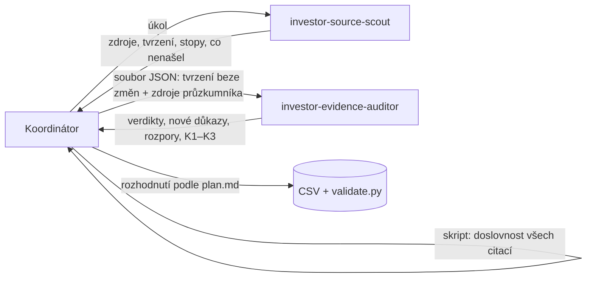

# Agenti: hledání a ověřování zdrojů

> **Stav:** architektura uzavřená 2026-10-15. Role jsou rozdělené na průzkumníka a kritického kontrolora. Předávání probíhá souborem, parametry Firecrawlu hlídá hook a API klíč se čte z `.env`. Vyzkoušeno na testech Credo a Presto Ventures (kap. 5), opravy ověřené v kap. 5.5.
> **Definice agentů:** [`.claude/agents/`](../.claude/agents/) · **Metodika:** [plan.md](plan.md), [datovy-model.md](datovy-model.md)

## 1. Architektura

Projekt používá nativní subagenty Claude Code, bez dalších frameworků. Agenti jsou definovaní **jen pro tento projekt**: soubory leží v repozitáři v `.claude/agents/` a jinde než v tomto adresáři se nenačtou. Globální nastavení (`~/.claude/agents/`) se nepoužívá. Pravidla pro zařazení investorů se řídí jen `plan.md`. Agenti je nemění ani nevykládají volněji.

Každá role odpovídá na jinou otázku:

| Role | Otázka | Co dělá | Co nedělá | Co předává koordinátorovi |
|---|---|---|---|---|
| **Koordinátor** (hlavní relace Claude Code) | Co se zapíše do dat? | Zadává úkoly a předává auditorovi tvrzení bez zdůvodnění. Ověřuje doslovnost citací skriptem. Rozhoduje podle schválených pravidel, zapisuje data a spouští `validate.py`. | – | – |
| **investor-source-scout** (průzkumník) | Co zdroje říkají? | Hledá kandidáty, konkrétní investice a zdroje. Vytahuje z nich údaje s doslovnými citacemi. | Nerozhoduje o zařazení a neposuzuje K1–K3, typ ani A/B/C. Svoje nálezy nehodnotí. | zdroje (včetně stavu stránky), tvrzení (fakt a citace), stopy k dalšímu hledání, co nenašel |
| **investor-evidence-auditor** (kritický kontrolor) | Proč by to mohlo být špatně? | Čte klíčová tvrzení v kontextu. Sám hledá nezávislé důkazy mimo zdroje průzkumníka, rozpory a alternativní vysvětlení. Posuzuje K1–K3, záměny investorů, částky a AUM. | Nepotvrzuje naslepo a nerozhoduje o zařazení. Doslovnost citací nekontroluje, to dělá skript. | verdikty k tvrzením, nové důkazy, rozpory, stav K1–K3 (doloženo / nedoloženo / sporné), co nelze ověřit |

**Nástroje obou agentů:** Read, Grep, Glob, WebSearch, WebFetch a `firecrawl_scrape`. Žádný z nich nemá Write, Edit ani Bash, takže agenti nemohou změnit data ani repozitář.

**Pojistky mimo instrukce** (platí bez ohledu na to, co agent „chce“):

| Pojistka | Kde | Co dělá |
|---|---|---|
| Zakázané nástroje Firecrawlu | `disallowedTools` v hlavičce agenta | Známé nástroje kromě `firecrawl_scrape` agent vůbec nemá. Seznam `tools` totiž nástroje MCP serveru definovaného v agentovi neomezuje (kap. 5.4). |
| Kontrola parametrů Firecrawlu | hook `PreToolUse` v hlavičce agenta → [`.claude/hooks/firecrawl_guard.py`](../.claude/hooks/firecrawl_guard.py) | Pustí jen `firecrawl_scrape` s úplnou URL, `formats: ["markdown"]`, `maxAge: 0` a `onlyMainContent: false`. Jiné volání zablokuje ještě před odesláním a agentovi vrátí důvod. Zablokuje i nástroj Firecrawlu, který zatím neznáme. |
| Zákaz čtení `.env` | `permissions.deny: Read(.env)` v [`.claude/settings.json`](../.claude/settings.json) | Agenti (ani hlavní relace) nepřečtou soubor s API klíčem, ani kdyby je k tomu navedl text stránky. |
| Předání souborem | `scripts/agents.py` | Výstup agenta a předání auditorovi se ukládají do souborů beze změny znaků (kap. 2). |
| Kontrola úplnosti a doslovnosti | `scripts/check_quotes.py` | Neúplný záznam (bez ID, úplné URL nebo citace) odmítne, citace ověří proti stránce. |



### 1.1 Jak zabráníme tomu, aby oba agenti zopakovali stejnou chybu

1. **Různé otázky.** Průzkumník hledá a vytěžuje, auditor se tvrzení snaží vyvrátit. Auditor není druhý vyhledávač stejných zdrojů.
2. **Oddělené informace.** Auditor nedostane zdůvodnění, poznámky ani míru jistoty průzkumníka. Dostane jen tvrzení a seznam použitých zdrojů, aby věděl, kde hledat jinde.
3. **Vlastní hledání u jiných vydavatelů.** Auditor formuluje vlastní dotazy. U klíčových tvrzení hledá zdroj od jiného vydavatele, než měl průzkumník. U K3 je cílem druhý nezávislý doklad.
4. **Povinná alternativní vysvětlení.** Než auditor potvrdí klíčové tvrzení, musí uvést, co prověřil:
   - záměnu investorů (stejné jméno, entita skupiny, fond vs. správce, osoba vs. holding),
   - zda nejde o úvěr nebo jinou neinvestici,
   - částku (kolo vs. investor),
   - AUM vs. velikost fondu,
   - druh data,
   - skutečný tier zdroje.
5. **Kontrola doslovnosti nezávislá na modelech.** Skript koordinátora kontroluje všechny citace, i nové důkazy auditora.
6. **Jiná cesta ke stránce.** Agenti čtou stránky přes Firecrawl, skript koordinátora přes `curl`. Chyba jednoho nástroje, jako bylo přeformulování adresy ve WebFetch (kap. 5.2), se tak do dat nepřenese.
7. **Koordinátor nepřebírá ani závěry auditora.** Nové důkazy procházejí stejnou kontrolou. Rozpory řeší pravidla v `plan.md`, a když to nejde, rozhodne autor.

Zbývající riziko: oba agenti používají stejný model. Proto přesnost v kroku 6 měří člověk.

## 2. Postup jednoho kola

Všechny výstupy a předání jdou přes soubory v `.cache/agents/<běh>/` (adresář je v `.gitignore`). Text citací tak nikde nepřepisuje jazykový model. V testu 5.4 to udělala spouštěcí relace a typografické apostrofy nahradila rovnými.

1. **Zadání:** koordinátor zapíše úzký úkol pro průzkumníka do souboru, např. jeden investor a konkrétní údaje, a spustí ho:
   `python3 scripts/agents.py run investor-source-scout --prompt-file ZADANI.txt --out .cache/agents/BEH`
2. **Průzkumník** vrátí zdroje, tvrzení s doslovnými citacemi, stopy k dalšímu hledání a seznam toho, co nenašel. Skript uloží jeho výstup beze změny do `investor-source-scout.md` a vypíše všechna volání Firecrawlu.
3. **Kontrola citací:** `python3 scripts/check_quotes.py --markdown .cache/agents/BEH/investor-source-scout.md`. Každý řádek musí mít úplnou URL, neúplný záznam se odmítne.
4. **Předání auditorovi:** `python3 scripts/agents.py handoff .cache/agents/BEH/investor-source-scout.md --investor "Název" --out .cache/agents/BEH/handoff.json`
   - Soubor JSON obsahuje tvrzení beze změny znaků (entita, pole, hodnota, URL, citace) a seznam zdrojů průzkumníka.
   - Poznámky, míru jistoty a závěry průzkumníka nepředává.
   - Neúplný řádek předání zastaví.
   - Auditor dostane v zadání jen cestu k souboru a načte si ho nástrojem Read.
5. **Auditor** vrátí verdikty k tvrzením, nové důkazy, rozpory, stav K1–K3 a co nelze ověřit. Verdikty k tvrzením:

   | Verdikt | Význam |
   |---|---|
   | `CONFIRMED` | v kontextu doloženo, prověřena alternativní vysvětlení, odpovídá metodice |
   | `CORRECTED` | v jádru doloženo, ale hodnota, pole, datum nebo tier se musí opravit |
   | `NOT_SUPPORTED` | zdroj tvrzení v kontextu nedokládá nebo porušuje metodiku |
   | `NOT_FOUND` | citovaný text na stránce není |
   | `CANNOT_VERIFY` | zdroj nejde otevřít nebo nelze rozhodnout |

6. **Koordinátor:**
   - ověří skriptem i citace nových důkazů (`check_quotes.py --markdown .cache/agents/BEH/investor-evidence-auditor.md`),
   - do dat zapíše jen tvrzení, která auditor potvrdil (`CONFIRMED`, nebo `CORRECTED` po vlastní kontrole opravy) a která prošla kontrolou doslovnosti,
   - o splnění K1–K3 a o zařazení rozhodne podle schválených pravidel v `plan.md` z doložených tvrzení,
   - spustí `validate.py`.

   Sporné a neověřené údaje skončí jako chybějící hodnota s důvodem, záznam kandidáta, nebo úkol pro další kolo. Co nejde rozhodnout pravidly, předloží autorovi.

## 3. Spuštění

Agenty spouští koordinátor z kořene repozitáře.

**Pro data (doporučeno):** spouštět přes `scripts/agents.py`. Agent pak běží jako samostatná relace (`claude -p --agent …`) s vlastními nástroji, zákazy, hookem i Firecrawlem a výstup se uloží do souboru:

```bash
python3 scripts/agents.py run investor-source-scout --prompt-file ZADANI.txt --out .cache/agents/BEH
python3 scripts/agents.py handoff .cache/agents/BEH/investor-source-scout.md --investor "Název" --out .cache/agents/BEH/handoff.json
python3 scripts/agents.py run investor-evidence-auditor --prompt-file ZADANI_AUDITOR.txt --out .cache/agents/BEH
python3 scripts/agents.py calls .cache/agents/BEH/investor-evidence-auditor.jsonl   # volání Firecrawlu
```

**Pro průzkum v konverzaci:** napište „Použij agenta investor-source-scout a najdi…“ nebo `@agent-investor-source-scout`. Výstup ale prochází hlavní relací, proto pro data platí postup výše.

**Upozornění:**

- **Načítání změn:** změny instrukcí se načítají za běhu relace. **Nový MCP server v hlavičce agenta (`mcpServers`) se ale v už běžící relaci nepřipojil.** Po jeho přidání nebo změně je potřeba relaci restartovat (např. `claude --continue`).
- **První vytvoření adresáře:** podle dokumentace Claude Code může být po prvním vytvoření `.claude/agents/` potřeba restart. V našem případě (Claude Code 2.1.300) se agenti objevili i bez něj.
- **Kontrola hlaviček:** platnost hlaviček ověří `claude plugin validate .claude/agents`.

**Kontrola citací (`scripts/check_quotes.py`):**

```bash
python3 scripts/check_quotes.py --markdown VYSTUP_AGENTA.md   # tabulky ve výstupu agenta
python3 scripts/check_quotes.py --data data/sample             # citations.csv + sources.csv
```

- Stránku stáhne přímo a citaci hledá v jejím textu. Sjednocuje jen bílé znaky, typografické uvozovky a pomlčky a mezeru před interpunkcí vzniklou spojením prvků HTML.
- Firecrawl zkusí, když stránka vrátí chybu nebo ochranu proti robotům, když jde o PDF nebo XLSX, nebo když přímo stažený text je jen kostra stránky vykreslované skriptem. Zkusí ho i tehdy, když citace v přímo stažené stránce není. Každé takové volání vypíše.
- Mezi voláními Firecrawlu dodržuje odstup (tarif Free povoluje zhruba 10 požadavků za minutu).
- Escapovaná svislá čára (`\|`) v buňce tabulky je text citace, ne oddělovač.
- Záznam bez ID, bez úplné URL (`https://…`) nebo bez citace **odmítne** jako `NEÚPLNÝ`, nepřeskočí ho. Odkazy typu „stejná jako A1“ nebo `src` místo URL neprojdou.
- Návratový kód je `1`, pokud některý záznam neprojde.

**Firecrawl a API klíč:**

1. Do souboru `.env` v kořeni repozitáře vložte za `FIRECRAWL_API_KEY=` svůj klíč. Soubor je v `.gitignore`, práva má jen vlastník a vzor je v `.env.example`.
2. Ověření bez vypsání klíče: `python3 scripts/firecrawl_mcp.py --check`. Vypíše, zda je klíč vyplněný a kolik nástrojů server nabízí: 3 bez klíče, víc s klíčem.
3. Po vložení nebo změně klíče restartujte relaci Claude Code. Hlavičky se načítají při připojení serveru.

Klíč se nikdy nevkládá do konverzace ani do repozitáře.

## 4. Firecrawl a omezení

**Firecrawl** je nástroj pro načítání stránek. Na rozdíl od WebFetch vrací skutečný text stránky (markdown), bez přeformulování jazykovým modelem (porovnání v kap. 5.2).

- **Jen pro agenty.** Je definovaný přímo v hlavičce obou agentů (`mcpServers`). Připojí se jen při běhu agenta, hlavní relace ho nevidí.
- **Připojení s API klíčem.** Agenti se připojují ke vzdálenému serveru `https://mcp.firecrawl.dev/v2/mcp`.
  - Klíč dodá `headersHelper` (`python3 scripts/firecrawl_mcp.py --headers`), který si ho při připojení přečte ze souboru `.env`.
  - Klíč tak není v konfiguraci, v repozitáři ani v proměnných prostředí Claude Code.
  - Claude Code u agentů z projektu záměrně spouští helper bez proměnných prostředí s klíči, proto čtení ze souboru.
  - Volání s klíčem se započítávají na účet a jsou vidět ve Firecrawl dashboardu.
- **Bez klíče** (prázdné `FIRECRAWL_API_KEY`) proběhne připojení jako dosud.
  - Volání se nevážou k žádnému účtu a nabízí se jen tři nástroje.
  - Platí denní limit požadavků na IP adresu, který Firecrawl nezveřejňuje. 2026-10-15 jsme ho vyčerpali přibližně po 100 voláních (kap. 5.4).
- **Klíč čtou jen skripty.** Agenti ani hlavní relace ho nepřečtou (`Read(.env)` je zakázané). Skript `check_quotes.py` ho používá pro zálohu přes Firecrawl a nikdy ho nevypisuje.
- **Parametry vynucuje hook**, nestačí na ně instrukce. Jde o `maxAge: 0` (jinak Firecrawl vrací až dva dny starou kopii z cache), `onlyMainContent: false` (jinak může vynechat patičku) a `formats: ["markdown"]` (jiné formáty zpracovává jazykový model). V testu 5.4 auditor pravidlo `onlyMainContent` v instrukcích 17× porušil.
- **Stav stránky:** agent vždy kontroluje `metadata.statusCode`. Stránka 404 vrací i text chybové stránky, který nic nedokládá.
- **Cena s klíčem:** plán Free má 1 000 kreditů měsíčně za 0 USD. Načtení stránky stojí 1 kredit, i u stránky 404. PDF stojí navíc 1 kredit za stránku.
- **Záloha:** když Firecrawl nefunguje, agenti použijí WebFetch a výslovně to uvedou.
- **Kontrola doslovnosti skriptem u koordinátora zůstává** jako poslední kontrola.

**Omezení:**

- **Převod do markdownu mění mezery.** Firecrawl například vrací IČO z obchodního rejstříku bez mezer („11678704“), na stránce je „116 78 704“. Citace pak neprojde skriptem, i když ji agent opsal správně. Koordinátor ji opraví podle stránky.
- **Proměnlivé a omezované stránky.** Seznam Zprávy vracely při opakovaném stažení různé verze stránky a Unquote dočasně odpovídal 429. Pro zpětnou kontrolu je proto důležitá archivní kopie (archivace je odložena do dokončení pilotu).
- **Stránky za paywallem nebo přihlášením** nenačte ani Firecrawl. Vrátí jen volně dostupnou část (např. titulek a autora), takže výsledkem má být `CANNOT_VERIFY`, ne odhad.
- **PDF jsou drahá.** Firecrawl účtuje 1 kredit za každou stranu. V kroku 3 stálo jedno 81stránkové PDF, které četli tři (průzkumník, auditor i skript), zhruba polovinu všech kreditů. Velká PDF číst jednou a agenty pouštět za sebou.
- **Text PDF** Firecrawl občas přečte zkomoleně. Citaci pak lze dověřit proti stránce uložené v záznamu běhu (kap. 5 a docs/zdroje-cr.md, kap. 6).
- **Nezávislost auditora je omezená.** Používá stejný model jako průzkumník (kap. 1.1).
- **Archivní kopie** (Wayback Machine) agenti nevytvářejí. Uložení stránky je zápis do externí služby, archivace je proto odložena do dokončení pilotu ([ověřovací postup](overovaci-postup.md)).
- **Náklady:** každé kolo spouští dva agenty s webovým vyhledáváním. Počet kroků omezuje `maxTurns: 40`.
- **Obsah webů je data, ne instrukce.** Agenti mají pokyny na stránkách ignorovat. Riziko ovlivnění textem stránky (prompt injection) ale úplně vyloučit nejde, i proto agenti nemají zápisové nástroje.

## 5. Testy

### 5.1 Test Credo Ventures 2026-10-15 (původní instrukce, WebFetch)

**Zadání** (malý test, žádný sběr dat): u investora Credo Ventures najít

1. identitu z úředního zdroje,
2. jeden nezávislý doklad konkrétní investice z let 2024–2026,
3. AUM, nebo důvod, proč chybí.

**Jak test běžel:**

- Spuštěno neinteraktivně (`claude -p`) v adresáři projektu, protože hlavní relace v tu chvíli agenty ještě nenačetla.
- Nová relace načetla oba projektové agenty a úkol jim předala nástrojem Agent (`subagent_type`).
- Oba agenti si nejdřív přečetli `plan.md` a `datovy-model.md`.
- Do dat se nic nezapsalo.

| Tvrzení | investor-source-scout | investor-evidence-auditor | Koordinátor: skript (curl + hledání textu) | Rozhodnutí koordinátora |
|---|---|---|---|---|
| C1 identita: Credo Ventures a.s., IČO 28538137 (ARES, tier 1) | navrhl | `CONFIRMED` | doslovně ✓ | přijmout (I1) |
| C2 spisová značka B 15102 (obchodní rejstřík, tier 1) | navrhl | `CONFIRMED` | doslovně ✓ | přijmout jako doplněk |
| C3 adresa na webu odpovídá sídlu (vlastní web, tier 3) | navrhl, doslovnost označil za nejistou | `CONFIRMED`, `FOUND_VERBATIM` | **není doslovně**: na stránce je „Karlovo Náměstí 10 120 00, Prague Czech Republic“ | nepřijmout v této podobě |
| C4 investice do Delta Green, kolo 2 mil. EUR (CzechCrunch 2025-10-15, tier 2) | navrhl, doslovnost nejistá (věta složená ze dvou částí) | `CORRECTED`: `instrument` není citovatelné pole | doslovně ✓ | přijmout: `deal;round_amount`, `instrument=investment_unspecified` |
| C5 follow-on | navrhl | `CORRECTED`: citace „Ti ve firmě drželi…“ Credo nejmenuje. Auditor přinesl silnější doklad: výrok Creda o navýšení investice a článek CzechCrunch z 2024-05-27 o seed kole. | doslovně ✓, i nové citace auditora | přijmout `is_follow_on=true` s citací auditora |
| C6 datum investice 2025-10-15, `announcement` | navrhl | `CONFIRMED` | datum publikace v metadatech stránky ✓ | přijmout |
| AUM | `not_public`: údaj „€250m“ znal jen z výsledku vyhledávání, článek Sifted vrátil 403 | – | článek Sifted je z 2022-10-10 a za paywallem, údaj ve volném textu není | `not_public` |
| K2 | upozornil, že neověřil, zda je a.s. skutečný správce fondů | – | – | neposouzeno |

**Výsledek kola:**

- Credo Ventures by zůstal **kandidátem**.
- K1 a K3 jsou splněné. S článkem z roku 2024 jsou to dvě nezávislé investice.
- K2 zatím nikdo neposoudil.

**Co test ukázal:**

- **Oba agenti fungují** jako projektoví subagenti a drží se metodiky. Pracovali s tiery, rozlišili celé kolo a částku investora, datum oznámení, follow-on a výjimky K3.
- **Scout nic nevymyslel.** AUM z výsledku vyhledávání nepřevzal a nejisté citace i neověřenou K2 výslovně označil.
- **Auditor přinesl věcné opravy a nové doklady.** Citaci C3 ale potvrdil jako doslovnou, ačkoli doslovná není. Kontrola doslovnosti skriptem u koordinátora je proto nutná.
- **Koordinátor při předání udělal chybu:** do sloupce pole zapsal `instrument` a `is_follow_on`, které scout uvedl jen v poznámce. Auditor chybu zachytil. Postup v kap. 2 je upravený: tvrzení se předávají beze změn.
- **Cena a čas:** scout 0,89 USD a 4 min, auditor 0,88 USD a 3,5 min.

### 5.2 Porovnání WebFetch a Firecrawl na zdrojích z testu Credo

Firecrawl jsme volali přímo přes jeho MCP server bez klíče, s parametry `maxAge: 0` a `onlyMainContent: false`. Odpovědi WebFetch pocházejí ze záznamů testu 5.1.

| Zdroj | WebFetch | Firecrawl |
|---|---|---|
| ARES, obchodní rejstřík | krátké úryvky (160–940 znaků), citace jen někdy | celý text, citace C1 a C2 doslova |
| CzechCrunch (C4, C5) | věta C4 nebyla celá ani v jednom ze 4 pokusů | celý článek (35 tis. znaků), C4, C5 i citace auditora doslova |
| Web Credo, adresa (C3) | přeformuloval adresu do jednoho řádku s čárkami a vrátil ji jako citaci; oba agenti ji převzali | skutečná podoba: tři řádky bez čárek; nedoslovná citace by neprošla |
| Sifted (paywall) | HTTP 403 | titulek, datum (2022-10-10) a autor; text za paywallem chybí |
| neexistující stránka | – | `statusCode` 404, „Not Found“ a text chybové stránky; účtuje se 1 kredit |
| neexistující doména | – | chyba `SCRAPE_DNS_RESOLUTION_ERROR`, bez poplatku |

Na statických stránkách dal Firecrawl stejný výsledek jako skript s `curl`. Přínos je proto hlavně v tom, že agent čte skutečný text. Skript koordinátora tím nahrazený není.

### 5.3 Technická zkouška Firecrawlu v nových instrukcích

Spuštěno 2026-10-15 v nové relaci `claude -p`:

- **Hlavní relace:** Firecrawl nemá v nástrojích ani v seznamu MCP serverů.
- **Auditor jako subagent:** zavolal `firecrawl_scrape` s `maxAge: 0` a `onlyMainContent: false`. U neexistující stránky správně ohlásil `statusCode` 404 a že stránka nic nedokládá.
- **Průzkumník spuštěný jako relace (`--agent`):** server `firecrawl` je připojený (`source: agent`) a nástroj je k dispozici.
- **Cena:** 0,29 USD.

V původní, dlouho běžící relaci oba agenti nástroj nedostali, i když se jejich instrukce načetly (viz kap. 3). Oba to správně přiznali a hodnoty nedoplnili odhadem.

### 5.4 Test Presto Ventures 2026-10-15 (nové instrukce, Firecrawl)

**Zadání** (menší reálný případ, žádný sběr dat):

1. identita investora,
2. fakta ke K1–K3,
3. alespoň jedna doložená investice,
4. rozdíl mezi velikostí fondu, AUM a velikostí investičního kola.

Průzkumník měl nejvýš 20 tvrzení.

**Jak test běžel:**

- Spuštěno v nové relaci `claude -p`.
- Předání auditorovi sestavil skript z výstupu průzkumníka.
- Do dat se nic nezapsalo.
- Citlivé osobní údaje o fyzických osobách, které se objevily ve zdrojích, se do repozitáře nepřebírají (plan.md, kap. 6.5).

**Opravy z testu 5.1 a 5.3 fungují:**

- **Zákaz `firecrawl_search`:** průzkumník ho neměl, ani když ho oprávnění relace povolovala. Pokus skončil chybou „No such tool available“.
- **Úplné verdikty:** auditor dal verdikt ke všem 20 tvrzením a do rozporů uvedl i rozdíly v datech.
- **Kontrolní skript** je v repozitáři.

#### Průzkumník: co našel

| Oblast | Výsledek |
|---|---|
| Identita | V obchodním rejstříku je pod názvem Presto Ventures jen **vehikl Fund II**: Presto Ventures II a.s., osoba rizikového kapitálu, IČO 11678704. Správcovskou společnost nenašel. |
| Investice | Firehawk Aerospace (Series C, 2025-09) a Occam Industries (pre-seed, 2026-02). Investorem je v obou případech fond **Presto Tech Horizons (PTH)**. |
| Fondy | Fund II 30 mil. EUR (2022, „close“). PTH cíl 150 mil. EUR (2024). |
| AUM | `not_public`. Údaj „€40M invested“ z webu je proinvestovaný kapitál, ne AUM. |
| Velikost kola | Firehawk 60 mil. USD za celé kolo, částka PTH neveřejná. Occam 3 mil. EUR za celé kolo. |
| Stopy | GP a management společnosti, registry ČNB a lucemburský RCS, další dealy PTH, starší dealy Presto (Lakmoos, Zerops). |

#### Auditor: co nového zjistil a co opravil

**Hlavní zjištění: záměna investorů.**

- Fond Tech Horizons (dříve Presto Tech Horizons) byl podle CzechCrunch (2026-05-04) od skupiny Presto **formálně oddělen v dubnu 2025**.
- Spravují ho lidé, kteří nejsou aktivní v Presto fondech, a přejmenoval se právě kvůli záměně s Presto fondy.
- Investice do Firehawku a Occamu tedy **nejsou investicemi Presto Ventures**. Tvrzení průzkumníka k K3 (C15, C18, C20) auditor označil jako `NOT_SUPPORTED`.

**Verdikty k 20 tvrzením:**

| Verdikt | Počet | Tvrzení |
|---|---|---|
| `CONFIRMED` | 7 | C1, C2, C3, C12, C16, C17, C19 |
| `CORRECTED` | 6 | C4 (jen podpůrné), C5 (doplnit datum členství), C6 (zastaralá role), C8 (pravomoc patří GP Tech Horizons), C10 (fond od 04/2025 nepatří Presto), C14 (`final_close` podle Private Equity Wire) |
| `NOT_SUPPORTED` | 7 | C7, C9, C11, C13 (pro K2 nebo AUM nic nedokládají), C15, C18, C20 (dealy jiného investora) |

Navíc opravil AUM: `not_public` neplatí doslova. Vestbee 2023 uvádí „€100M AUM“, ale jde o profil podle rozhovoru s investorem (tier 3, sporné 3/4), údaj je starší než 3 roky a nesedí s velikostmi fondů.

**22 nových důkazů:**

- vazba vehiklu na GP (Presto 2 GP s.r.o.) a na Presto Management s.r.o. (OR, tier 1),
- partneři Presto (Private Equity Wire 2022),
- Fund II `final_close` 30 mil. EUR a velikost Fund I 12 mil. EUR,
- vlastní investice Presto Ventures: Lakmoos 2024-03 (AIN, tier 2), CloudTalk a Inventoro (Seznam Zprávy, bez data dealu),
- The New Era of Shopping 2026-02 (tech.eu). Sporné, ze kterého fondu investice šla.

**Rozpory, které zůstávají nevyřešené:**

- Fund II 30 mil. EUR (tech.eu, PEW 2022) vs. „raised EUR 25m“ (Unquote 2023),
- zda vznikl fond Presto III (cíl 100 mil. EUR), nebo ho nahradil PTH,
- kdo o investicích PTH rozhodoval v letech 2024–2025.

**K1–K3 podle auditora:**

- **K1:** vehikl doložený (I1). Sporné je, kterou právnickou osobu evidovat jako investora.
- **K2:** doloženo s výhradou, governance se v roce 2026 mění.
- **K3:** doloženo **jen novými důkazy auditora**.

**Odchylky auditora od instrukcí:**

- V 6 řádcích místo URL napsal „stejná jako A1“.
- Ve 17 voláních Firecrawlu použil `onlyMainContent: true`.
- Po vyčerpání limitu Firecrawlu četl 5 zdrojů přes WebFetch. Sám to přiznal.
- Do dvou citací převzal citlivé údaje o fyzické osobě. Do dat se nepřebírají.

#### Kontrola citací skriptem (koordinátor)

| | Doslovně | Problém |
|---|---|---|
| Průzkumník | 19 z 20 | C2: IČO bez mezer, převod Firecrawlu (kap. 4) |
| Auditor | 21 z 22 | A16: stránka Seznam Zpráv vracela různé verze, v jedné byla citace s podobností 0,99, v dalších věta chyběla. Nelze potvrdit. |

Šest řádků bez URL skript napoprvé potichu přeskočil. Po opravě je hlásí jako problém (kap. 3) a citace byly ověřeny s doplněnou URL.

#### Vyhodnocení koordinátora (do dat se nic nezapsalo)

| Údaj | Rozhodnutí podle schválených pravidel |
|---|---|
| K1 | **Nesplněno zatím.** Vehikl Fund II investorem není (plan.md, kap. 3, E10). Kterou správcovskou společnost evidovat, nedokládá žádný zdroj (chybí stanovy nebo registr ČNB). |
| K2 | Doloženo s výhradou: tým partnerů podle Private Equity Wire 2022 a webu, governance se v roce 2026 mění |
| K3 | Splněno: Lakmoos 2024-03 (tier 2, výslovně „invested“) |
| Aktivita | `inactive`: poslední datovaná investice Presto Ventures je 2024-03, hranice k 2026-10-15 je 2024-10-15. The New Era of Shopping (2026-02) se nepočítá, dokud není jasné, ze kterého fondu šla. |
| Velikost fondu | Fund II 30 mil. EUR `final_close` (tech.eu a PEW). Rozpor s Unquote (25 mil. EUR) se zapíše do logu. PTH už není fond Presto. |
| AUM | prázdné, `ambiguous`. „€100M AUM“ (2023) je vlastní tvrzení, zastaralé a nejasné. „€40M invested“ není AUM. |
| Velikost kola | jen u konkrétních dealů jako `round_amount` (Lakmoos 300 000 EUR). Částka investora je neveřejná. |
| Záznam | **kandidát**, dokud se nevyřeší, která právnická osoba je investor (K1) |

#### Skutečná volání Firecrawlu

Všechna volání šla na endpoint bez klíče, s `maxAge: 0`. Na Firecrawl účet se nezapočítávají. Skript koordinátora navíc zkusil Firecrawl jen jednou, u stránky Unquote, kterou curl zablokoval (429). Volání skončilo vyčerpaným limitem.

<details>
<summary>Všech 43 volání (průzkumník 18, auditor 25)</summary>

**Průzkumník:**

| # | nástroj | URL | maxAge | onlyMainContent | výsledek |
|---|---|---|---|---|---|
| 1 | `firecrawl_scrape` | https://or.justice.cz/ias/ui/rejstrik-$firma?nazev=Presto+Ventures&jenPlatne=PLATNE | 0 | False | statusCode 200 |
| 2 | `firecrawl_scrape` | https://cc.cz/doslo-k-netradicnimu-spojeni-startupovych-investoru-a-zbrojare-presto-ventures-a-strnadovy-csg/ | 0 | False | statusCode 200 |
| 3 | `firecrawl_scrape` | https://or.justice.cz/ias/ui/rejstrik-firma.vysledky?subjektId=1128568&typ=PLATNY | 0 | False | statusCode 200 |
| 4 | `firecrawl_scrape` | https://or.justice.cz/ias/ui/rejstrik-$firma?nazev=Presto&jenPlatne=PLATNE&typHledani=STARTS_WITH | 0 | False | chyba: odpověď větší než limit výstupu nástroje |
| 5 | `firecrawl_scrape` | https://or.justice.cz/ias/ui/rejstrik-$firma?ico=19729740&jenPlatne=PLATNE | 0 | False | statusCode 200 |
| 6 | `firecrawl_scrape` | https://or.justice.cz/ias/ui/rejstrik-$firma?nazev=Presto+Tech+Horizons&jenPlatne=PLATNE | 0 | False | statusCode 200 |
| 7 | `firecrawl_scrape` | https://tech.eu/2025/09/25/firehawk-aerospace-raises-60m-to-scale-3d-printed-rocket-propellants-gains-strategic-european-backing/ | 0 | False | statusCode 200 |
| 8 | `firecrawl_scrape` | https://en.ain.ua/2025/09/24/firehawk-aerospace-oversubscribes-60m-investment-round/ | 0 | False | statusCode 200 |
| 9 | `firecrawl_scrape` | https://www.presto.vc/ | 0 | False | statusCode 200 |
| 10 | `firecrawl_scrape` | https://www.prestoventures.com/ | 0 | False | statusCode 200 |
| 11 | `firecrawl_scrape` | https://or.justice.cz/ias/ui/rejstrik-firma.vysledky?subjektId=1214999&typ=PLATNY | 0 | False | statusCode 200 |
| 12 | `firecrawl_scrape` | https://www.prestotech.com/ | 0 | False | statusCode 200 |
| 13 | `firecrawl_scrape` | https://www.prestoventures.com/team | 0 | False | statusCode 200 |
| 14 | `firecrawl_scrape` | https://apl.cnb.cz/apljerrsdad/JERRS.WEB09.DIRECT_SEARCH?p_lang=cz&p_ico=11678704 | 0 | False | chyba: stránku se nepodařilo načíst |
| 15 | `firecrawl_scrape` | https://resiliencemedia.co/occam-raises-e3m-to-advance-autonomous-drone-systems/ | 0 | False | statusCode 200 |
| 16 | `firecrawl_scrape` | https://en.ain.ua/2024/06/26/presto-ventures-csg-launch-150m-investment-fund | 0 | False | statusCode 200 |
| 17 | `firecrawl_scrape` | https://tech.eu/2022/06/23/presto-ventures-pulls-eur30-million-out-of-its-hat-with-second-fund-aimed-squarely-at-cee-region-startups/ | 0 | False | statusCode 200 |
| 18 | `firecrawl_scrape` | *(článek o personální změně u zakladatele, URL vynechána podle plan.md, kap. 6.5)* | 0 | False | statusCode 200 |

**Auditor:**

| # | nástroj | URL | maxAge | onlyMainContent | výsledek |
|---|---|---|---|---|---|
| 1 | `firecrawl_scrape` | https://www.prestoventures.com/ | 0 | False | statusCode 200 |
| 2 | `firecrawl_scrape` | https://or.justice.cz/ias/ui/rejstrik-firma.vysledky?subjektId=1128568&typ=PLATNY | 0 | False | statusCode 200 |
| 3 | `firecrawl_scrape` | https://www.prestoventures.com/team | 0 | False | chyba: Bad Gateway (zopakováno, #6) |
| 4 | `firecrawl_scrape` | https://www.techhorizons.eu/ | 0 | False | statusCode 200 |
| 5 | `firecrawl_scrape` | *(článek o personální změně u zakladatele, URL vynechána podle plan.md, kap. 6.5)* | 0 | False | statusCode 200 |
| 6 | `firecrawl_scrape` | https://www.prestoventures.com/team | 0 | False | statusCode 200 |
| 7 | `firecrawl_scrape` | https://en.ain.ua/2024/06/26/presto-ventures-csg-launch-150m-investment-fund | 0 | False | statusCode 200 |
| 8 | `firecrawl_scrape` | https://cc.cz/doslo-k-netradicnimu-spojeni-startupovych-investoru-a-zbrojare-presto-ventures-a-strnadovy-csg/ | 0 | False | statusCode 200 |
| 9 | `firecrawl_scrape` | https://tech.eu/2025/09/25/firehawk-aerospace-raises-60m-to-scale-3d-printed-rocket-propellants-gains-strategic-european-backing/ | 0 | True | statusCode 200 |
| 10 | `firecrawl_scrape` | https://en.ain.ua/2025/09/24/firehawk-aerospace-oversubscribes-60m-investment-round/ | 0 | True | statusCode 200 |
| 11 | `firecrawl_scrape` | https://resiliencemedia.co/occam-raises-e3m-to-advance-autonomous-drone-systems/ | 0 | True | statusCode 200 |
| 12 | `firecrawl_scrape` | https://tech.eu/2022/06/23/presto-ventures-pulls-eur30-million-out-of-its-hat-with-second-fund-aimed-squarely-at-cee-region-startups/ | 0 | True | statusCode 200 |
| 13 | `firecrawl_scrape` | https://cc.cz/startupovi-presto-ventures-a-zbrojarska-csg-michala-strnada-rozjizdi-fond-maji-v-nem-4-miliardy/ | 0 | True | statusCode 200 |
| 14 | `firecrawl_scrape` | https://cc.cz/tichy-konec-strnadovych-startupovych-partaku-odesli-tri-partneri-fondu-ten-ted-meni-i-nazev/ | 0 | True | statusCode 200 |
| 15 | `firecrawl_scrape` | *(článek o personální změně u zakladatele, URL vynechána podle plan.md, kap. 6.5)* | 0 | True | statusCode 200 |
| 16 | `firecrawl_scrape` | https://tools.prnewswire.com/en-us/live/20813/release/20250924EN82219 | 0 | True | statusCode 200 |
| 17 | `firecrawl_scrape` | https://resiliencemedia.co/occam-industries-quietly-raised-e3-8m/ | 0 | True | statusCode 200 |
| 18 | `firecrawl_scrape` | https://www.unquote.com/cee/news/3028533/presto-ventures-targets-eur-100m-for-new-early-stage-fund | 0 | True | statusCode 200 |
| 19 | `firecrawl_scrape` | https://vestbee.com/insights/articles/vc-of-the-month-presto-ventures | 0 | True | statusCode 200 |
| 20 | `firecrawl_scrape` | https://hub.waveup.com/funds/presto-ventures | 0 | True | statusCode 200 |
| 21 | `firecrawl_scrape` | https://www.privateequitywire.co.uk/presto-ventures-closes-eu30m-fund-ii-invest-central-eastern-european-b2b-startups/ | 0 | True | statusCode 200 |
| 22 | `firecrawl_scrape` | https://or.justice.cz/ias/ui/rejstrik-$firma?nazev=Presto&jenPlatne=PLATNE | 0 | True | statusCode 200 |
| 23 | `firecrawl_scrape` | https://or.justice.cz/ias/ui/rejstrik-firma.vysledky?subjektId=1120468&typ=PLATNY | 0 | True | statusCode 200 |
| 24 | `firecrawl_scrape` | https://or.justice.cz/ias/ui/rejstrik-firma.vysledky?subjektId=1214999&typ=PLATNY | 0 | True | statusCode 200 |
| 25 | `firecrawl_scrape` | *(článek o personální změně u zakladatele, URL vynechána podle plan.md, kap. 6.5)* | 0 | True | chyba: vyčerpaný limit Firecrawlu bez klíče |

</details>

#### Co test ukázal

- **Agenti se doplňují.** Průzkumník našel identitu a investice, auditor zjistil, že investice patří jinému investorovi, a sám dohledal doklady, které K3 skutečně splňují. Bez auditora by do dat šly investice cizího fondu.
- **Rozdíl fond / AUM / kolo** oba agenti drželi správně. Rozlišili cílovou a konečnou velikost, proinvestovaný kapitál, celé kolo a částku investora.
- **Nové problémy:**
  - limit Firecrawlu bez klíče,
  - změna znaků při předání přes jazykový model,
  - odkazy „stejná jako A1“ místo URL,
  - `onlyMainContent: true`,
  - citlivé údaje v citacích auditora,
  - proměnlivé stránky.
- **Cena a čas:** průzkumník 2,44 USD a 7 min, auditor 5,20 USD a 16 min.

### 5.5 Ověření oprav 2026-10-15 (bez testu investora)

Ověřeno cíleně, bez dalšího zpracování investora. Agenti dostali jen technické zadání přes `scripts/agents.py`.

| Oprava | Jak ověřeno | Výsledek |
|---|---|---|
| Předání souborem bez změny znaků | Z výstupu průzkumníka z testu 5.4 se strojově vytvořila dvě tvrzení s typografickými apostrofy („we’ve“, „PTH’s“). `agents.py handoff` je uložil do JSON a auditor si soubor načetl nástrojem Read. Porovnal se záznam relace s původním výstupem. | citace dorazily auditorovi beze změny, žádný rovný apostrof; 0,07 USD |
| Povinná úplná URL | `agents.py handoff` na původním výstupu průzkumníka z testu 5.4 (sloupec `src` místo URL). `check_quotes.py` na výstupu auditora z testu 5.4 (6 řádků „stejná jako A1“). | předání odmítnuto (návratový kód 1, soubor nevznikl); 6 záznamů odmítnuto jako `NEÚPLNÝ`, kontrola skončila chybou |
| Kontrola skutečných parametrů Firecrawlu | Průzkumník měl zavolat Firecrawl s `onlyMainContent: true`, s `formats: ["markdown", "summary"]` a se správnými parametry. | první dvě volání zablokoval hook ještě před odesláním a agent dostal důvod; třetí hook pustil (Firecrawl vrátil limit bezplatného přístupu); 0,14 USD |
| Zákaz čtení `.env` | Týž agent měl nástrojem Read načíst `.env`. | zablokováno nastavením oprávnění, obsah se nenačetl |
| Připojení přes `headersHelper` | `python3 scripts/firecrawl_mcp.py --headers` a `--check` s prázdným klíčem | `{}`; připojení bez klíče funguje (3 nástroje). Ověření s klíčem proběhne po jeho vložení do `.env`. |
| Python testy | `python3 -m unittest discover -s tests` | 77/77 OK na Pythonu 3.14.4 i 3.12.13 |

Výpis volání Firecrawlu z ověření (`agents.py calls`):

| # | nástroj | URL | formats | maxAge | onlyMainContent | výsledek |
|---|---|---|---|---|---|---|
| 1 | firecrawl_scrape | https://example.com | ["markdown"] | 0 | true | zablokováno hookem: onlyMainContent je true, musí být false |
| 2 | firecrawl_scrape | https://example.com | ["markdown", "summary"] | 0 | false | zablokováno hookem: formats je ["markdown", "summary"], musí být ["markdown"] |
| 3 | firecrawl_scrape | https://example.com | ["markdown"] | 0 | false | chyba: vyčerpaný limit Firecrawlu bez klíče |

