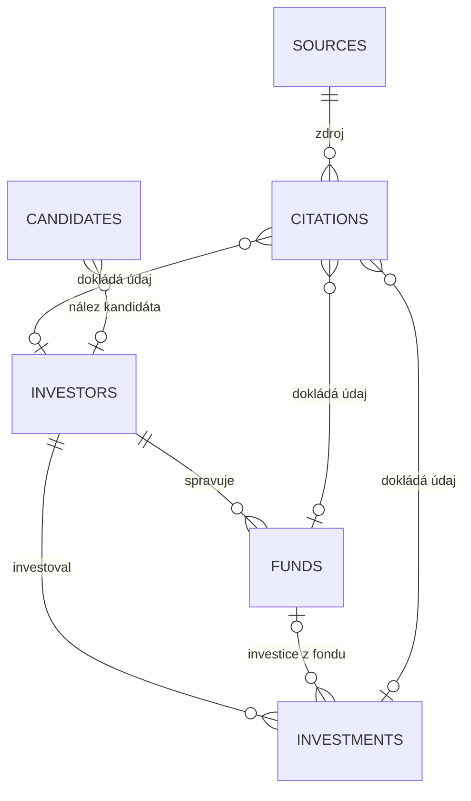

# Datový model

> **Stav:** krok 2 hotový
> **Poslední úprava:** 2026-10-16
> **Navazuje na:** [plan.md](plan.md) · **Validátor:** [scripts/validate.py](../scripts/validate.py) · **Testy:** [tests/test_validate.py](../tests/test_validate.py) · **Fiktivní příklady:** [data/examples/](../data/examples/)

## 1. Principy

1. **Strukturovaná data v pěti CSV tabulkách** (UTF-8, oddělovač čárka, první řádek je hlavička). CSV jde otevřít v tabulkovém editoru, dobře se porovnává v gitu a nepotřebuje databázový server.
2. **Každý důležitý údaj má citaci se zdrojem.** Citace vždy odkazuje na zdroj (URL, vydavatel, datum publikace, datum přístupu, archivní kopie) a obsahuje krátký doslovný úryvek. Platí to i pro odvozené a odhadnuté hodnoty: popis výpočtu nestačí, musí být dohledatelné i původní zdroje. Podle citace jde zpětně ověřit, že údaj ve zdroji opravdu je a LLM si ho nevymyslela.
3. **Peněžní údaje nesdílejí žádný sloupec.** AUM, velikost fondu, typická investice, konkrétní investice a vklad zapsaný v rejstříku jsou samostatné údaje (viz kapitola 5).
4. **Nic se nedomýšlí.**
   - Chybějící údaj zůstává prázdný a má uvedený důvod.
   - Datum se ukládá jen s přesností, kterou uvádí zdroj.
   - Údaje z rejstříku se nepřebírají jako datum nebo výše investice.
5. **Odvozené hodnoty se neukládají.** Aktivitu, poslední doloženou investici, počet doložených investic a hodnocení A/B/C počítá validátor z dat, aby nemohly zastarat nebo si odporovat.

## 2. Jak jsou tabulky propojené



| Soubor | Jeden řádek = | K čemu slouží |
|---|---|---|
| `investors.csv` | jeden investiční subjekt (plan.md, kap. 3.1) | identita, typ, zaměření, typická investice, AUM. Obsahuje i kandidáty a vyřazené subjekty. |
| `funds.csv` | jeden fond investora | velikost jednotlivých fondů |
| `investments.csv` | jedna konkrétní investice | doklad, že investor opravdu investuje (K3), a podklad pro aktivitu |
| `sources.csv` | jeden zdroj | URL, vydavatel, tier, datum publikace a přístupu, archiv |
| `citations.csv` | jedna citace | spojuje údaj (entita + pole) se zdrojem a s krátkou citací |
| `candidates.csv` (nepovinný) | jeden nález kandidáta v jednom zdroji | odkud kandidáta máme (zdroj z katalogu, URL, datum, způsob nalezení) |

**Příklad dohledání původu údaje:** Typická investice Fiktivní Ventures je 250 000–2 000 000 EUR (`investors.csv`, INV-0001). V `citations.csv` ji dokládá CIT-0002 (`entity_id=INV-0001`, `fields` obsahuje `ticket`). Ta odkazuje na zdroj SRC-0005 v `sources.csv` (URL, datum přístupu, archiv) a obsahuje citaci „Investujeme 250 tisíc až 2 miliony eur…“.

## 3. Tabulky

Seznamy se zapisují do jedné buňky a oddělují středníkem (`software_saas;ai_data`). Kódy číselníků jsou v kapitole 7.

### 3.1 `investors.csv`

| Sloupec | Povinné | Formát | Popis |
|---|---|---|---|
| `investor_id` | vždy | `INV-0000` | ID záznamu |
| `record_status` | vždy | číselník | `included` (zařazen), `candidate` (zatím nesplňuje K1–K3), `rejected` (vyřazen) |
| `rejection_code` | u `rejected` | `E1`–`E10` | důvod vyřazení (plan.md, kap. 8) |
| `merged_into` | u `E10` | `INV-0000` | nadřazený záznam, pod který se subjekt sloučil |
| `name` | vždy | text | název nebo jméno |
| `aliases` | – | seznam | dřívější názvy, značky |
| `primary_type` | u `included` | číselník | základní typ (plan.md, kap. 4) |
| `subtype` | – | číselník | forma subjektu. Základní typ neurčuje (plan.md, kap. 4.2). |
| `country` | u `included` | ISO 3166-1 alpha-2 | země HQ, u fyzické osoby země působení |
| `city` | – | text | město sídla investičního týmu (např. `Praha`). Vyplňuje se jen s citací `city`, z poznámek se nevytěžuje. |
| `website` | – | URL | web subjektu |
| `registry_type`, `registry_id` | u úrovně I1 | číselník + číslo | IČO a LEI se kontrolují kontrolním součtem |
| `identity_level` | u `included` | `I1`, `I2`, `I3` | úroveň identity (plan.md, K1) |
| `sectors` | u `included` | seznam z číselníku | odvětví, do kterých investuje (18 kategorií) |
| `sectors_original` | u vyplněných `sectors` | seznam | **původní označení ze zdroje, doslovně**, např. `softwarových;AI;deeptech` |
| `sectors_status` | u `included` | stav | původ hodnoty, nebo důvod, proč chybí |
| `stages` + `stages_status` | u `included` | seznam + stav | fáze investic |
| `geographies` + `geographies_status` | u `included` | seznam + stav | země (ISO kódy) nebo regiony, kam investuje |
| `ticket_min`, `ticket_max`, `ticket_currency` + `ticket_status` | u `included` | částka, měna + stav | **typická investice** do jedné firmy, jak ji deklaruje zdroj. Není to konkrétní investovaná částka ani limit programu. |
| `ticket_scope` | – | text | ke které strategii nebo programu se deklarovaný ticket vztahuje (např. `growth equity`), pokud jich investor má víc |
| `aum_amount`, `aum_currency`, `aum_basis`, `aum_as_of` + `aum_status` | u `included` | částka, měna, číselník, datum + stav | **celkový kapitál investora (AUM)** |
| `notes` | – | text | interní poznámka, není to zdroj |

**Sloupce `*_status`.** Každá skupina popisných údajů má jeden stavový sloupec. Ten říká buď, **odkud hodnota je**, nebo **proč chybí** (plan.md, kap. 10):

| Hodnota je vyplněná | Hodnota chybí |
|---|---|
| `reported`: hodnotu uvádí zdroj | `not_public`: veřejně dostupná není |
| `derived`: odvozená z doložených údajů | `conflicting`: zdroje si odporují |
| `estimate`: odhad | `not_applicable`: nedává smysl (např. AUM u fyzické osoby) |
| | `ambiguous`: zdroj údaj uvádí, ale není jasné, co představuje |

- U zařazeného investora musí mít každá skupina buď hodnotu, nebo důvod.
- Vyplněná hodnota bez stavu je chyba vždy, i u kandidáta.
- U `derived` a `estimate` musí citace odkazovat na **původní zdroj** (s úryvkem) a v `note` popsat metodu.

**Původní označení sektorů.** Číselník sjednocuje odvětví pro vyhledávání. Doslovné označení ze zdroje se ale uchovává vedle něj, aby šlo zařazení zpětně zkontrolovat. Validátor ověřuje, že každé původní označení je doslovně v některé citaci sektorů. Pokud není, vydá varování.

### 3.2 `funds.csv`

| Sloupec | Povinné | Formát | Popis |
|---|---|---|---|
| `fund_id` | vždy | `FND-0000` | ID fondu |
| `investor_id` | vždy | `INV-0000` | investor, který fond spravuje |
| `name` | vždy | text | název fondu |
| `vintage_year` | – | `YYYY` | rok vzniku fondu |
| `domicile_country` | – | ISO 3166-1 alpha-2 | domicil fondu (může se lišit od HQ investora) |
| `size_amount`, `size_currency` | – | částka, měna | **velikost fondu** (committed capital jednoho fondu) |
| `size_type` | u velikosti | `target`, `first_close`, `final_close` | cílová velikost, první uzavření, nebo konečná velikost |
| `size_as_of` | u velikosti | datum | ke kterému dni velikost platí |
| `size_status` | u velikosti | `reported`, `not_public`, `conflicting`, `ambiguous` | velikost fondu se neodvozuje ani neodhaduje |
| `notes` | – | text | poznámka |

### 3.3 `investments.csv`

| Sloupec | Povinné | Formát | Popis |
|---|---|---|---|
| `deal_id` | vždy | `DEAL-0000` | ID investice |
| `investor_id` | vždy | `INV-0000` | kdo investoval |
| `fund_id` | – | `FND-0000` | z jakého fondu. Fond musí patřit stejnému investorovi. |
| `company_name` | vždy | text | firma, do které se investovalo |
| `company_country` | – | ISO 3166-1 alpha-2 | země firmy |
| `company_registry_type`, `company_registry_id` | – | číselník + číslo | registrace firmy |
| `investment_date` | – | `YYYY`, `YYYY-MM` nebo `YYYY-MM-DD` | **datum investice**, jen se známou přesností |
| `date_basis` | u data | `announcement`, `stated_in_source` | odkud datum investice je |
| `instrument` | vždy | číselník | druh investice. `unclear` = nevíme, zda nejde o půjčku (viz níže). |
| `round_stage` | vždy | číselník | fáze kola, nebo `unknown` |
| `is_follow_on` | vždy | `true`, `false`, `unknown` | další investice do firmy, kde už investor podíl má |
| `round_amount`, `round_currency` | – | částka, měna | **velikost celého kola** |
| `investor_amount`, `investor_currency` | – | částka, měna | **částka tohoto investora** v kole |
| `registry_entry_date` | – | datum | **datum zápisu společníka** do obchodního rejstříku. Není to datum investice. |
| `registry_contribution_amount`, `registry_contribution_currency` | – | částka, měna | **vklad zapsaný v rejstříku**. Není to výše investice. |
| `notes` | – | text | poznámka |

**Hodnoty `instrument`:**

| Hodnota | Kdy | Počítá se jako doklad investování? |
|---|---|---|
| `equity` | podíl nebo akcie | ano |
| `convertible_loan` | úvěr s možností převodu na podíl | ano |
| `safe` | SAFE | ano |
| `other_quasi_equity` | jiná forma quasi-equity | ano |
| `investment_unspecified` | zdroj **výslovně oznamuje investici** (investice, investor, podíl, akcie, společník), ale neuvádí formu | ano, pokud to citace výslovně obsahuje (viz níže) |
| `unclear` | **nevíme, zda jde o kapitálovou investici, nebo o půjčku**, např. „poskytl finance“, „podpořil firmu“ | **ne**, investice se jen eviduje |

Čistě dluhové financování se do `investments.csv` nezapisuje vůbec (plan.md, kap. 3).

**Kontrola `investment_unspecified`.** Obecná zmínka o financování nestačí (plan.md, K3). Validátor proto počítá investici jako doklad jen tehdy, když citace `deal`:

- obsahuje výraz pro investici nebo vlastnictví (`invest…`, `podíl`, `akcie`, `akcionář`, `společník`, `stake`, `shares`, `shareholder`),
- a zároveň neobsahuje výraz pro půjčku (`úvěr`, `půjč…`, `dluh…`, `loan`, `debt`). Například „investiční úvěr“ je půjčka.

Pokud tomu žádná nezávislá citace nevyhoví, validátor vydá varování `INVESTMENT_NOT_EXPLICIT` a investici nepočítá. Řešení: citovat větu, která investici výslovně uvádí, nebo změnit nástroj na `unclear`. Jde o hrubou kontrolu textu pro pilot (čeština a angličtina). Smysl citace nakonec posuzuje člověk při ověřování ([ověřovací postup](overovaci-postup.md)).

### 3.4 `sources.csv`

| Sloupec | Povinné | Formát | Popis |
|---|---|---|---|
| `source_id` | vždy | `SRC-0000` | ID zdroje |
| `url` | vždy | URL | adresa zdroje |
| `publisher` | vždy | text | vydavatel |
| `title` | – | text | titulek |
| `tier` | vždy | `1`–`4` | úroveň zdroje (plan.md, kap. 6.1). Nezávislé jsou tier 1 a 2. |
| `published_date` | – | `YYYY`, `YYYY-MM` nebo `YYYY-MM-DD` | datum publikace, pokud ho zdroj uvádí |
| `accessed_date` | vždy | `YYYY-MM-DD` | kdy byl zdroj přečten |
| `archive_url` | doporučené | URL | archivní kopie (Wayback Machine). Když chybí, validátor varuje. |

### 3.5 `citations.csv`

| Sloupec | Povinné | Formát | Popis |
|---|---|---|---|
| `citation_id` | vždy | `CIT-0000` | ID citace |
| `entity_type` | vždy | `investor`, `fund`, `investment` | jaký záznam citace dokládá |
| `entity_id` | vždy | ID | konkrétní záznam |
| `fields` | vždy | seznam | které údaje záznamu citace dokládá (viz kapitola 4) |
| `source_id` | **vždy** | `SRC-0000` | zdroj. U odvozené nebo odhadnuté hodnoty původní zdroj, ze kterého výpočet vychází. |
| `quote` | vždy | text ≤ 300 znaků | **doslovný úryvek ze zdroje** v původním jazyce |
| `note` | u `derived`, `estimate` a vyřazení `E9` | text | popis metody odvození nebo odhadu, u E9 výsledek prověření, jinak volitelný komentář |

### 3.6 `candidates.csv` (původ kandidátů)

Nepovinný soubor. Když existuje, validátor ho kontroluje. Popisuje, **odkud kandidáta máme**, ne údaje o něm: ty se dokládají citacemi v ostatních tabulkách. Kandidát nalezený ve více zdrojích má víc řádků se stejným `candidate_id`.

| Sloupec | Povinné | Formát | Popis |
|---|---|---|---|
| `candidate_id` | vždy | `CAN-0000` | ID kandidáta, u všech jeho nálezů stejné |
| `name` | vždy | text | jméno nebo název, jak je ve zdroji |
| `found_via` | vždy | `ZDR-00` nebo `TYP-00` | zdroj z katalogu [data/sources/catalog.csv](../data/sources/catalog.csv) |
| `found_url` | vždy | URL | konkrétní stránka |
| `found_date` | vždy | `YYYY-MM-DD` | kdy byl kandidát nalezen |
| `how` | vždy | `list`, `search`, `deal_report`, `portfolio` | seznam (členové, LP, regulátor), vyhledávání, článek nebo oznámení o investici, portfolio jiného investora nebo akcelerátoru |
| `investor_id` | – | `INV-0000` | záznam v `investors.csv`. **Prázdné, dokud kandidáta neověříme.** Všechny nálezy jednoho kandidáta musí mít stejné. |
| `note` | – | text | např. „mimo pilot: investiční tým sídlí mimo ČR“ (plan.md, kap. 11.1) |

**Fyzické osoby** (např. andělé jmenovaní v článcích) se zapisují, jen když jsou předmětem ověřování. Jinak stačí jejich počet (plan.md, kap. 6.5, minimalizace údajů).

### 3.7 Kontrola duplicit a párování

Jsou to dvě různé věci:

- **Kontrola duplicit (validátor, automaticky):**
  - Hlásí, když mají dva záznamy v `investors.csv` stejné registrační číslo, i když je jeden z nich vyřazený (`DUPLICATE_REGISTRY_ID`). Stejné IČO znamená stejnou právnickou osobu, a ta má jeden záznam.
  - Hlásí, když nálezy jednoho kandidáta míří k různým záznamům (`CANDIDATE_INVESTOR_MISMATCH`).
  - Nic neslučuje ani nepřepisuje.
- **Párování (koordinátor, podle [ověřovacího postupu](overovaci-postup.md), bod 3):**
  - rozhoduje, ke kterému záznamu nové zjištění patří,
  - u značky s více právnickými osobami rozhoduje, kdo má skutečnou investiční pravomoc a které osoby se sloučí jako E10,
  - zatím se dělá ručně.

## 4. Doložení údajů

**Pole, která lze citovat:**

| Entita | Pole v `fields` |
|---|---|
| `investor` | `identity` (název + registrace), `primary_type`, `decision_authority` (posouzení K2), `country`, `city`, `sectors`, `stages`, `geographies`, `ticket`, `aum`, `rejection` |
| `fund` | `fund` (existence fondu), `size` |
| `investment` | `deal` (investice proběhla), `investment_date`, `round_amount`, `investor_amount`, `registry_entry_date`, `registry_contribution` |

Jedna citace může dokládat víc polí, pokud je její úryvek podporuje všechna (např. `deal;investment_date`).

**Kdy je citace povinná:**

| Situace | Požadavek |
|---|---|
| Každý vyplněný důležitý údaj: popisné údaje investora, `registry_id`, `country`, `city`, `primary_type`, každý fond a jeho velikost, každá investice, její datum, částky a údaje z rejstříku | ≥1 citace se zdrojem (tier 1–3) a úryvkem |
| Stav `derived` nebo `estimate` | navíc popis metody v `note` |
| Stav `ambiguous` nebo `conflicting` | ≥1 citace se zdrojem, která nejasný nebo rozporný údaj ukazuje |
| Stav `not_public` nebo `not_applicable` | citace není potřeba |
| Zařazený investor (`included`) | citace `decision_authority` (K2) se zdrojem tier 1–3 |
| Vyřazení (`rejected`) | citace `rejection` se zdrojem (plan.md, kap. 8: kód + zdroj) |
| Vyřazení kódem `E9` | navíc v `note` citace `rejection` výsledek prověření: co se prověřilo a co podezření potvrdilo |

**Další pravidla:**

- Zdroj tier 4 (agregátor) nikdy nedokládá údaj. Slouží jen k hledání kandidátů.
- **Datum údaje** je u každé citace dané zdrojem (`published_date`, `accessed_date`). AUM a velikost fondu mají navíc vlastní datum platnosti (`as_of`).
- Citace se nepočítá a validátor ji hlásí jako chybu, pokud:
  - nemá zdroj,
  - nemá úryvek,
  - odkazuje na neexistující zdroj,
  - odkazuje na zdroj tier 4.

## 5. Peněžní údaje se nezaměňují

| Údaj | Tabulka | Úroveň | Sloupce | Pravidla |
|---|---|---|---|---|
| **AUM** (celkový kapitál investora) | `investors` | celý investor | `aum_*` | Musí mít `aum_basis` a `aum_as_of`. **Nikdy se nedopočítává** z fondů a **není to celkový upsaný kapitál fondů**. U fyzických osob se nevyplňuje. Starší než 3 roky → varování. |
| **Velikost fondu** | `funds` | jeden fond | `size_*` | Musí mít `size_type` (target / first_close / final_close) a datum. Jen `reported`, žádné součty fondů. |
| **Typická investice** (ticket) | `investors` | obecné rozpětí investora | `ticket_*` | „Od“ ≤ „do“, jedna měna pro obě meze. |
| **Konkrétní investice** | `investments` | jeden deal | `round_*`, `investor_*` | Velikost celého kola a částka tohoto investora jsou dva samostatné údaje. Částka investora ≤ kolo (při stejné měně). |
| **Vklad zapsaný v rejstříku** | `investments` | jeden deal | `registry_contribution_*` | **Není to výše investice.** Viz kapitola 6. |

**Pro všechny částky platí:**

- Zapisují se jako číslo v základních jednotkách, bez mezer a zkratek: `1500000`, ne `1,5 mil.`.
- **Měna (ISO 4217) je povinná vždy, když je vyplněná částka.**
- Přepočet na jinou měnu se zatím neřeší a neukládá.

**`aum_basis` říká, co částka představuje:**

- `aum`: zdroj výslovně uvádí spravovaný majetek („spravuje“, „assets under management“),
- `regulatory_aum`: regulatorní údaj, např. Form ADV. Regulatorní definice může zahrnovat i nesplacené závazky investorů fondu, proto se vede jako samostatný druh.

**AUM vs. celkový upsaný kapitál fondů:**

- Hodnota `total_commitments` v číselníku záměrně není. Celkový upsaný kapitál fondů se do AUM nezapisuje, ani když ho zdroj uvede jako jedno číslo. Zapisují se jednotlivé fondy do `funds.csv`.
- Validátor varuje, když se AUM shoduje s velikostí některého fondu (`AUM_MATCHES_FUND_SIZE`) nebo se součtem fondů (`AUM_MATCHES_FUND_TOTAL`). Shoda může být oprávněná (např. správce s jediným fondem), proto jde o varování k ruční kontrole.

**Nejasný kapitál:** Pokud zdroj jen uvádí, že subjekt „disponuje kapitálem X“, a není jasné, co to je, **AUM zůstává prázdné** se stavem `aum_status=ambiguous`. Nejasnou větu dokládá citace.

## 6. Data a údaje z obchodního rejstříku

- Datum se ukládá ve formátu ISO 8601 **jen s přesností, kterou uvádí zdroj**: `2023`, `2023-07`, nebo `2023-07-14`. Neznámé části se nedoplňují (plan.md, kap. 7.1).
- Datum `YYYY-01-01` validátor hlásí jako varování, protože často jde o domyšlený den a měsíc.
- `date_basis` u investice říká, odkud datum je:
  - `announcement`: oznámení dealu,
  - `stated_in_source`: zdroj datum nebo rok investice výslovně uvádí.
- Datum publikace zdroje, který o investici mluví jen zpětně, **není datem investice**. Investice pak zůstane bez data. K zařazení stačí (K3 se splní přes `published_date` zdroje), ale stav `active` nezakládá.
- Data v budoucnosti a neexistující data (`2024-02-30`) jsou chyba.

**Obchodní rejstřík.** Datum zápisu společníka ani zapsaný vklad nejsou datum a výše investice:

- Zápis bývá až po investici.
- Vklad do základního kapitálu bývá jen zlomek skutečné investice (zbytek tvoří ážio), např. vklad 20 000 Kč při investici v řádu milionů.

Proto:

- Oba údaje se ukládají do vlastních sloupců (`registry_entry_date`, `registry_contribution_*`) a mají vlastní citace.
- **`date_basis=registry_entry` neexistuje.** Datum zápisu nepatří do `investment_date`.
- Validátor hlásí chybu, když se `investment_date` shoduje s datem zápisu (`REGISTRY_DATE_AS_INVESTMENT_DATE`). Stejně tak, když se částka kola nebo investora shoduje se zapsaným vkladem ve stejné měně (`REGISTRY_CONTRIBUTION_AS_AMOUNT`).
  - Chyba se hlásí jen tehdy, když hodnotu nedokládá žádný jiný zdroj než výpis z rejstříku.
  - Pokud datum výslovně uvádí jiný zdroj (např. tisková zpráva), shoda je v pořádku.
- **Zápis společníka dokazuje vlastnictví podílu, ne investiční transakci.** Samotný zápis proto nesplní K3 ani nezakládá stav `active` (plan.md, kap. 6.4).
  - Zdroj, ze kterého pochází zápis (cituje `registry_entry_date` nebo `registry_contribution`), se u téže investice jako doklad nepočítá, i když cituje i `deal`.
  - K3 splní až další doklad transakce: související listina ze sbírky listin (tier 1) nebo důvěryhodné oznámení (tier 2). Listina se zapíše jako samostatný zdroj a cituje se pro `deal`, případně pro `investment_date` a částky.
  - Validátor nepozná, že zdroj je výpis z rejstříku, pokud se necituje pro pole `registry_*`. Výpis se proto vždy cituje pro tato pole.

## 7. Číselníky

| Číselník | Hodnoty |
|---|---|
| `record_status` | `included`, `candidate`, `rejected` |
| `rejection_code` | `E1`–`E10` (plan.md, kap. 8) |
| `primary_type` | `vc`, `pe`, `family_office`, `business_angel`, `large_private_investor` |
| `subtype` → povolené typy | `corporate` → vc; `accelerator`, `public`, `institutional`, `angel_fund` → vc, pe; `multi_family` → family_office |
| `identity_level` | `I1`, `I2`, `I3` |
| `registry_type` | `cz_ico`, `lei`, `uk_company_number`, `sec_crd`, `other` |
| `sectors` *(rozhodnuto)* | `software_saas`, `ai_data`, `fintech`, `health_life_sciences`, `cleantech_energy`, `mobility_transport`, `ecommerce_retail`, `consumer`, `edtech`, `proptech_construction`, `agrifood`, `industrial_manufacturing`, `deeptech_hardware`, `cybersecurity`, `media_gaming`, `logistics`, `business_services`, `generalist` |
| `stages` *(rozhodnuto)* | `pre_seed`, `seed`, `series_a`, `series_b`, `series_c_plus`, `growth`, `buyout` (u investice navíc `unknown`) |
| `geographies` *(rozhodnuto)* | kód země ISO 3166-1 alpha-2, nebo region `CEE`, `DACH`, `NORDICS`, `EUROPE`, `GLOBAL` |
| `aum_basis` | `aum`, `regulatory_aum` |
| `size_type` | `target`, `first_close`, `final_close` |
| `date_basis` | `announcement`, `stated_in_source` |
| `instrument` | `equity`, `convertible_loan`, `safe`, `other_quasi_equity`, `investment_unspecified`, `unclear` |
| `tier` | `1` úřední, `2` nezávislý, `3` vlastní tvrzení investora, `4` agregátor |

## 8. Odvozené hodnoty

Validátor je počítá při každém spuštění k zadanému dni (`--today`) a do CSV se neukládají.

| Hodnota | Jak se počítá |
|---|---|
| **Doložená investice** | Investice, která splňuje všechno: <br>• má nástroj jiný než `unclear`, <br>• má citaci `deal` ze **zdroje tier 1 nebo 2**, který **není výpisem zápisu v rejstříku** (necituje pole `registry_*` téže investice), <br>• u `investment_unspecified` citace výslovně zmiňuje investici (kapitola 3.3), <br>• má datum: datum investice, nebo datum publikace dokládajícího zdroje. Datum zápisu do rejstříku se nepočítá. |
| `documented_deals` | počet doložených investic |
| `last_investment_date` | nejnovější **datum investice** (`investment_date`) mezi doloženými investicemi. Datum zápisu do rejstříku se nepoužívá. Neúplná data se řadí podle nejstaršího možného dne. |
| `activity_status` | `active`, pokud poslední doložená investice **s jistotou** spadá do posledních 24 měsíců. U neúplného data rozhoduje nejstarší možný den. Jinak `inactive`. |
| `confidence_grade` | **A**: zařazený, splňuje K1, K2 a K3, investice dokládají ≥2 různé nezávislé zdroje. **B**: zařazený, jeden nezávislý zdroj. **C**: ostatní (kandidát, nesplněné K1–K3). |
| K2 ověřeno | `ověřeno`, pokud má investor citaci `decision_authority`, jinak `neověřeno` (u kandidáta to znamená, že K2 ještě nikdo neposoudil) |

**K1 (identita):**

- `I1` vyžaduje registrační číslo a citaci `identity` ze zdroje tier 1,
- `I2` vyžaduje citaci `identity` ze zdroje tier 1 nebo 2,
- `I3` k zařazení nestačí.

**K2 (vlastní rozhodování):**

- zařazený investor musí mít citaci `decision_authority` ze zdroje tier 1–3. Citace ukazuje, **na základě čeho** byla K2 posouzena (registr správce, vlastní prezentace, charakter investic s popisem v `note`),
- bez ní validátor hlásí `K2_NOT_MET` a investor nemůže být zařazený,
- zda úryvek rozhodovací pravomoc opravdu dokládá, posuzuje člověk.

**K3 (investice):** zařazený investor musí mít alespoň jednu doloženou investici.

## 9. Validátor a testy

```bash
python3 scripts/validate.py data/examples/valid --today 2026-10-14
python3 -m unittest discover -s tests -v
```

- Validátor používá jen standardní knihovnu Pythonu.
- **Vyzkoušeno na Pythonu 3.12.13 a 3.14.4.** Starší verze ověřené nejsou.
- Vypíše chyby, varování a přehled odvozených hodnot.
- Návratový kód je `1`, pokud najde chybu. Varování výsledek nemění.

| Oblast | Kódy |
|---|---|
| Struktura souborů (při chybě se dál nepokračuje) | `MISSING_FILE`, `MISSING_COLUMN`, `WRONG_DELIMITER`, varování `UNKNOWN_COLUMN` |
| Formát hodnot | `MISSING_VALUE`, `INVALID_ID`, `DUPLICATE_ID`, `INVALID_ENUM`, `INVALID_COUNTRY`, `INVALID_URL`, `INVALID_DATE`, `FUTURE_DATE`, `INVALID_AMOUNT`, `MISSING_CURRENCY`, `INVALID_CURRENCY`, `INVALID_REGISTRY_ID`, varování `UNKNOWN_CURRENCY`, `CURRENCY_WITHOUT_AMOUNT`, `POSSIBLE_PLACEHOLDER_DATE` |
| Propojení tabulek | `UNKNOWN_REFERENCE`, `FUND_INVESTOR_MISMATCH`, `INVALID_CITATION_FIELD`, `MERGED_INTO_INVALID`, varování `UNUSED_SOURCE` |
| Duplicity a původ kandidátů (kap. 3.6 a 3.7) | `DUPLICATE_REGISTRY_ID`, `UNKNOWN_SOURCE_KEY`, `CANDIDATE_INVESTOR_MISMATCH` |
| Doložení údajů | `MISSING_CITATION`, `MISSING_SOURCE`, `MISSING_QUOTE`, `MISSING_METHOD`, `AGGREGATOR_AS_EVIDENCE`, `MISSING_ORIGINAL_LABEL`, varování `ORIGINAL_LABEL_NOT_IN_QUOTE`, `QUOTE_TOO_LONG`, `MISSING_ARCHIVE` |
| Pravidla z plánu | `MISSING_STATUS`, `STATUS_VALUE_MISMATCH`, `SUBTYPE_TYPE_MISMATCH`, `TICKET_RANGE_INVALID`, `AMOUNT_EXCEEDS_ROUND`, `AUM_BASIS_REQUIRED`, `AUM_DERIVED_NOT_ALLOWED`, `AUM_FOR_NATURAL_PERSON`, `MISSING_AS_OF`, `FUND_SIZE_TYPE_REQUIRED`, `DATE_BASIS_REQUIRED`, `DATE_BASIS_WITHOUT_DATE`, `REGISTRY_DATE_AS_INVESTMENT_DATE`, `REGISTRY_CONTRIBUTION_AS_AMOUNT`, `REJECTION_CODE_REQUIRED`, `REJECTION_CODE_NOT_ALLOWED`, `E9_REVIEW_MISSING`, `K1_NOT_MET`, `K2_NOT_MET`, `K3_NOT_MET`, varování `STALE_VALUE`, `AUM_MATCHES_FUND_SIZE`, `AUM_MATCHES_FUND_TOTAL`, `INVESTMENT_NOT_EXPLICIT` |

**Testy:** `tests/test_validate.py` obsahuje 70 testů. Každý z 60 kódů validátoru má aspoň jeden test.

| Skupina | Počet | Co ověřuje |
|---|---|---|
| Ukázková data | 4 | platná sada bez hlášení, neplatná sada přesně se všemi vloženými chybami, odvozené hodnoty, návratové kódy |
| Případy z požadavků | 10 | chybějící měna, neznámé datum, nejasný kapitál, zdroje odvozených hodnot, nejasný nástroj, rejstřík a vklad v Kč, AUM vs. upsaný kapitál fondů |
| Poslední revize kroku 2 | 7 | K2, samotný zápis v rejstříku vs. zápis s listinou, obecné financování a investiční úvěr u `investment_unspecified`, ticket nad 500 tis. EUR neurčuje typ, E9 až po prověření |
| Duplicity a kandidáti | 6 | stejné IČO se hlásí, ale nic se neslučuje; stejné zahraniční číslo v jiné zemi není duplicita; víc nálezů jednoho kandidáta; jeden kandidát = jeden záznam; kandidát bez `investor_id`; `candidates.csv` je nepovinný |
| Hranice aktivity | 3 | rok, měsíc, přesná hranice 24 měsíců |
| Jedna změna v datech | 35 | 32 případů, kdy jedna úprava platných dat musí vyvolat konkrétní hlášení, a 3 případy struktury souborů |
| Pomocné funkce | 5 | data, kontrolní součty IČO a LEI, seznam zemí, výrazy pro výslovnou investici |

**Co validátor neověří:**

- že je zdroj správně zařazený do tier a že výpis z rejstříku je citovaný pro pole `registry_*`,
- zda citace `decision_authority` rozhodovací pravomoc opravdu dokládá (kontroluje se jen, že existuje),
- význam citace u `investment_unspecified` (jen hrubá kontrola výrazů),
- typ investora podle ticketu: hranice 500 tis. EUR je jen orientační (plan.md, kap. 4.3),
- párování: ke kterému záznamu zjištění patří a zda další právnickou osobu značky sloučit jako E10. Validátor jen hlásí duplicitní IČO (kap. 3.7).

Že citace na uvedené URL opravdu je, ověřuje samostatný skript `python3 scripts/check_quotes.py --data DATA_DIR` ([agenti.md](agenti.md), kap. 3).

**Pozor na Excel s českým nastavením:** ukládá CSV se středníkem jako oddělovačem. Validátor to pozná (`WRONG_DELIMITER`).

### 9.1 Přehled pro čtení (`investori_prehled.csv`)

CSV tabulky slouží k ukládání a ověřování údajů. Pro člověka, který chce rychle najít investora, je určený přehled, který se z nich **generuje**:

```bash
python3 scripts/export_overview.py data/sample --today 2026-10-16
```

- **Rozsah:** jeden řádek je jeden zařazený investor (`included`). Kandidáti a vyřazené záznamy, včetně sloučených E10, se nevypisují.
- **Ručně se neupravuje.** Pokud validátor najde chybu, přehled se nevytvoří.
- **Čitelné hodnoty:** kódy číselníků se převádějí na text (např. `series_a` → Series A, `CEE` → střední a východní Evropa). Odvozené hodnoty mají poznámku „(odvozeno)“.
- **Chybějící údaje** mají vždy důvod: nezveřejněno, zdroje si odporují, nevztahuje se, nejasné, nebo neuvedeno (údaj zatím není v datech). Nic se nedopočítává.
- **Aktivitu, poslední doloženou investici, počet doložených investic a hodnocení A/B** počítá validátor a přehled je jen přebírá. Poslední doložená investice je ta, která splňuje K3. Novější investice s nástrojem `unclear` nebo doložená jen vlastním zdrojem investora se do ní nepočítá.
- **Oddělené údaje:**
  - Ticket se vypisuje jako „deklarované rozpětí“ nebo „deklarovaná výše“, případně se strategií z `ticket_scope`. Nezaměňuje se s konkrétní investovanou částkou ani s limitem programu.
  - Velikost každého fondu se vypisuje zvlášť, AUM samostatně.
- **Doložené investice:** sloupec „Doložené investice (firmy)“ vypisuje firmy, datum a fázi u všech investic, které splňují K3 (nejvýš 8, od nejnovější). Investice s nástrojem `unclear`, doložené jen zápisem v rejstříku nebo jen vlastním zdrojem investora a dluhové financování se nevypisují.
- **Dohledatelnost:** sloupce „Zdroje: …“ uvádějí ke každé skupině údajů URL zdroje a ID citace ve tvaru `URL (CIT-0000)`. Doslovnou citaci k ID najdete v `citations.csv`.

Testy přehledu jsou v `tests/test_export_overview.py` (8 testů).

## 10. Fiktivní příklady

Adresář [data/examples/](../data/examples/) obsahuje **jen fiktivní data**:

- Názvy jsou vymyšlené.
- URL jsou na rezervované doméně `.example`.
- IČO 99999994, 99999986 a 99999901 mají platný kontrolní součet, ale v ARES neexistují (ověřeno 2026-10-14).

Sady jsou dvě:

- `valid/`: správně zapsaná data včetně okrajových případů, i s `candidates.csv` (kandidát nalezený ve dvou zdrojích, neověřený kandidát, kandidát mimo pilot). Validátor nehlásí žádnou chybu ani varování.
- `invalid/`: kopie platné sady s 38 záměrnými chybami a 3 varováními. Každá je popsaná ve sloupci `notes` a test ověřuje, že validátor najde přesně je.

| Případ | Správný zápis (`valid/`) | Chybný zápis (`invalid/`) → hlášení |
|---|---|---|
| **Chybějící měna** | ticket INV-0001 `250000`–`2000000` `EUR`, kolo DEAL-0001 `1500000 EUR` | ticket bez měny (INV-0001), kolo bez měny (DEAL-0001) → `MISSING_CURRENCY` |
| **Neznámé datum** | DEAL-0002 jen rok `2023`. DEAL-0003 bez data: INV-0002 zůstává zařazený, ale je `inactive`. | domyšlené `2023-01-01` → `POSSIBLE_PLACEHOLDER_DATE`; `2024-02-30` → `INVALID_DATE`; `2027-01-15` → `FUTURE_DATE`; datum bez `date_basis` → `DATE_BASIS_REQUIRED` |
| **Nejasný kapitál** | INV-0001: „disponuje kapitálem 1,2 miliardy korun“ → AUM prázdné, `aum_status=ambiguous`, citace CIT-0003 | INV-0006: kapitál zapsaný jako AUM → `AUM_BASIS_REQUIRED`, `MISSING_AS_OF`; INV-0002: osobní majetek jako AUM → `AUM_FOR_NATURAL_PERSON` |
| **Odvozená hodnota a její zdroj** | INV-0002: sektory a geografie odvozené z portfoliové firmy. CIT-0010 odkazuje na původní zdroj SRC-0007 a v `note` popisuje metodu. | CIT-0010 jen s popisem metody, bez zdroje → `MISSING_SOURCE`, `MISSING_CITATION` |
| **Nejasný nástroj** | DEAL-0006 „poskytl finance“ → `instrument=unclear`, evidovaná, ale nepočítá se. DEAL-0003 `investment_unspecified` s citací „Mezi našimi investory je i Jana Příkladová.“ se počítá. | DEAL-0003 `unclear` je jediná investice INV-0002 → `K3_NOT_MET`; DEAL-0006 „poskytl finance“ zapsaná jako `investment_unspecified` → varování `INVESTMENT_NOT_EXPLICIT` |
| **Rejstřík a vklad v Kč** | DEAL-0005: zápis společníka 2025-11-20 a vklad 20 000 Kč ve vlastních sloupcích, datum a výše investice prázdné. Samotný zápis investici nedokládá: INV-0001 má 2 doložené investice (DEAL-0001, DEAL-0002), ne 4, a poslední zůstává 2025-03-12. | DEAL-0010: datum zápisu a vklad 20 000 Kč převzaté jako datum a částka investice → `REGISTRY_DATE_AS_INVESTMENT_DATE`, `REGISTRY_CONTRIBUTION_AS_AMOUNT` |
| **K2 (vlastní rozhodování)** | INV-0001: „O každé investici … rozhoduje náš investiční výbor.“ (CIT-0018). INV-0002: „investuje vlastní peníze“ (CIT-0009). Kandidát INV-0003 K2 posouzenou nemá, to je v pořádku. | INV-0006 zařazený bez citace `decision_authority` → `K2_NOT_MET` |
| **E9 až po prověření** | – | INV-0008 vyřazený jako E9 jen kvůli varovným signálům, bez výsledku prověření → `E9_REVIEW_MISSING` |
| **AUM vs. upsaný kapitál fondů** | FND-0001 konečná velikost 40 mil. EUR, FND-0002 cílová 80 mil. EUR. AUM se z nich nepočítá. | INV-0001: AUM 120 mil. EUR jako součet fondů → `AUM_DERIVED_NOT_ALLOWED`, varování `AUM_MATCHES_FUND_TOTAL` |

## 11. Rozhodnutí a otevřené body

**Rozhodnuto 2026-10-15** (zapsáno i v plan.md, kap. 12):

- K2 je povinná a eviduje se citací `decision_authority`,
- samotný zápis společníka v rejstříku nesplní K3 ani nezakládá `active`,
- `investment_unspecified` se počítá jen při výslovném oznámení investice,
- E9 až po prověření (citace s výsledkem prověření),
- číselník 18 sektorů + doslovné původní označení ze zdroje,
- aktivita jen z investic doložených nezávislým zdrojem,
- důvod chybějící hodnoty `ambiguous`,
- fáze a regiony podle kapitoly 7,
- přepočet měn se zatím neřeší,
- odvozené a odhadnuté hodnoty s původními zdroji,
- nejasný nástroj se nepočítá jako důkaz,
- datum zápisu a vklad v rejstříku nejsou datum a výše investice,
- celkový upsaný kapitál fondů není AUM.

**Rozhodnuto 2026-10-16:**

- původ kandidátů v `candidates.csv`, `investor_id` až po ověření (kap. 3.6),
- validátor hlásí duplicitní IČO, párování zůstává na koordinátorovi (kap. 3.7).

**Otevřené:**

- **Archivní kopie zdrojů:** archivace je odložena do dokončení pilotu, validátor na chybějící `archive_url` upozorňuje (`MISSING_ARCHIVE`).
- V pilotu sledovat, jak často u českých VC chybí k zápisu v rejstříku další doklad transakce, a jestli výrazy pro `investment_unspecified` nevedou k zbytečným varováním.
